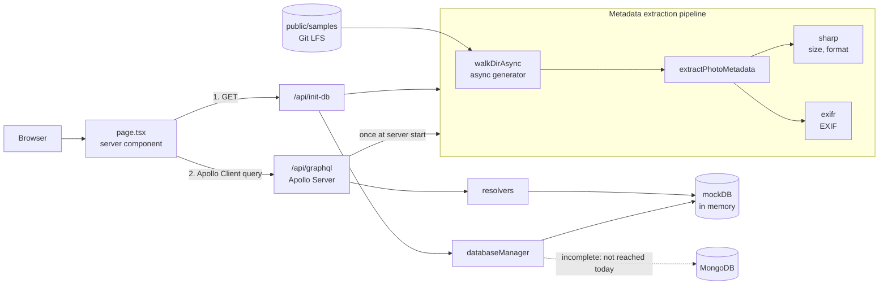

# image-insight

[](https://github.com/loquemedalagana/image-insight/actions/workflows/ci.yml)

[한국어](README.md) | English

A full-stack personal project on Next.js 15 that extracts image information and EXIF from local JPG files, serves it through a GraphQL API, and shows it in a gallery with a category filter.

| Item | Details |
| --- | --- |
| Role | Solo developer. I wrote the schema, API, metadata extraction logic, UI, tests and Docker setup myself |
| Period | 2025-01 to 2025-02 (82 commits, written without AI tools) / 2026-11 test, CI and docs cleanup (with Claude Code) |
| Core stack | TypeScript, Next.js 15 (App Router), React 19, Apollo Server and Client (GraphQL), graphql-codegen, sharp, exifr, Jest, Docker |
| Status | Local prototype. Not deployed, no operations, no authentication. Storage is an in-memory mockDB |

<!-- TODO(screenshot): add docs/screenshot-gallery.png, then uncomment the line below -->
<!--  -->

> Screenshot placeholder (to be added)

---

## Implemented

- **Metadata extraction**: walks the JPG files under `public/samples` recursively, reads size and format with sharp and EXIF (camera, lens, exposure, capture time, resolution and so on) with exifr, and merges them into one record. The folder name becomes the category.
- **GraphQL API** (`/api/graphql`)
  - Query: `metadata` (filter by category and file name), `metadataById`, `getCategoryList`
  - Mutation: `addMetadata`, `addCategory`, `deleteMetadataById`
- **DB init endpoint** (`/api/init-db`): loads the extracted metadata into the store
- **Gallery page**: queries with Apollo Client in a server component, category filter driven by the URL query, masonry list
- **Tests and CI**: 9 Jest tests (GraphQL API, DB init, extraction pipeline, EXIF parsing). GitHub Actions runs lint and tests
- **Docker/Compose** development environment

## Planned (not implemented)

These items have no code, or only a schema definition.

- Using MongoDB as the real store (only adapter code exists; see the tech stack section)
- NeRF preprocessing types, queries and mutations (defined in the GraphQL schema, no resolvers)
- EXIF-based calibration (`calibrationUtils.ts` is a skeleton)
- RAW formats such as CR3 (WebAssembly)
- Face recognition (face-api.js), in-browser image classification (TensorFlow.js)
- Cloud storage (Backblaze B2 or Wasabi)
- Person relationship data (Neo4j)
- WebGPU/WebGL image preprocessing
- Upload UI, thumbnails, pagination

---

## Tech stack

Based on `package.json` and the actual imports.

| Area | Technology | Notes |
| --- | --- | --- |
| Language | TypeScript 5 | strict mode |
| Framework | Next.js 15.1 (App Router), React 19 | API served by Route Handlers |
| API | Apollo Server 4, `@as-integrations/next`, GraphQL 16 | `/api/graphql` |
| Client | Apollo Client 3 | queried from a server component |
| Type generation | graphql-codegen | schema → `src/__generated__/graphql.ts` |
| Image processing | sharp 0.33, exifr 7 | size and format, EXIF |
| Storage | in-memory mockDB (the default, and the only store actually used) | reset on server restart |
| Storage (incomplete) | mongodb 6 driver | see below |
| Styling | Tailwind CSS 3 | |
| Testing | Jest 29 + ts-jest (ESM mode) | |
| Environment | Docker (node:18), Docker Compose, GitHub Actions (Node 20) | |
| File management | Git LFS | sample images in `public/samples` |

**MongoDB adapter status**: [`src/lib/mongoDB.ts`](src/lib/mongoDB.ts) and [`src/lib/databaseManager.ts`](src/lib/databaseManager.ts) contain a branch that uses MongoDB when `USE_MONGO_DB=true`. However, the code checks whether a connection exists before it ever tries to connect, so the connection never starts and everything falls back to mockDB. The GraphQL resolvers also call mockDB directly instead of going through `databaseManager`. For these reasons MongoDB is listed as incomplete, not supported.

`exif-js`, `formidable`, `supertest`, `node-mocks-http` and `@testing-library/*` are installed but not used by the current code.

---

## Architecture



1. When the page renders, it first calls `/api/init-db`, which loads the metadata of the sample folder into the store.
2. It then queries the category list and the metadata with Apollo Client. The filter passes the `categoryName` URL query straight through as `searchCondition`.
3. The resolvers read from mockDB and return the records that match.

---

## Getting started

### 0. Clone and sample images

```bash
git clone https://github.com/loquemedalagana/image-insight.git
cd image-insight
```

Sample images are stored with Git LFS. To see images in the gallery, pull the LFS files.

```bash
git lfs install
git lfs pull
```

Without the LFS files the samples stay as pointer text and the gallery looks empty. **The tests pass without LFS** (test images are regular files in `tests/fixtures`).

The samples are 50 cat photos I took myself (about 16MB). The folders `together`, `gray-tabby` and `brown-tabby` become the categories. For publishing, the long edge was reduced to 2000px, and camera and lens serial numbers and XMP were removed. Camera and lens model, exposure, capture date and the copyright notice were kept.

### 1. Run locally

Node.js 20 is recommended (`.nvmrc`).

```bash
npm ci
NEXT_PUBLIC_BASE_URL=http://localhost:3000 npm run dev
```

The gallery is at `http://localhost:3000` and the GraphQL endpoint is at `http://localhost:3000/api/graphql`. `NEXT_PUBLIC_BASE_URL` is required because the page uses it to call its own API.

### 2. Run with Docker

```bash
docker compose up --build
```

Without Compose:

```bash
docker build -t image-insight .
docker run -p 3000:3000 -e NEXT_PUBLIC_BASE_URL=http://localhost:3000 image-insight
```

### 3. Tests, lint, codegen

```bash
npm test          # 9 Jest tests (no LFS needed)
npm run lint      # ESLint
npm run codegen   # types.graphql → src/__generated__/graphql.ts
npm run build     # production build (needs NEXT_PUBLIC_BASE_URL)
```

---

## Design notes

**1. Schema-first GraphQL with codegen**
[`types.graphql`](src/graphql/schema/types.graphql) is the single source. [`codegen.yml`](codegen.yml) generates the server types and client documents into [`src/__generated__/graphql.ts`](src/__generated__/graphql.ts). The resolvers, mockDB and UI components share the same `Metadata` and `Category` types, so a schema change shows up at compile time wherever it matters.

**2. Directory traversal with async generators**
`getAllImagesAsync` in [`fileUtils.ts`](src/utils/fileUtils.ts) and `walkDirAsync` in [`extractMetadataFromLocal.ts`](src/lib/extractMetadataFromLocal.ts) recurse into subfolders with `yield*` and emit one file at a time. Files are processed one by one with `for await` instead of building the full path list first, and a file that fails is logged and skipped.

**3. Handling files without EXIF**
[`processExif.ts`](src/lib/processExif.ts) returns a `{ message }` object instead of throwing when a file has no EXIF or parsing fails. When EXIF exists, each field gets a default so the response shape stays the same. Both cases are covered with fixture images in [`processExif.test.ts`](tests/lib/processExif.test.ts).

**4. Docker to pin the Node version**
At the time, my local machine ran Node 22 and the assumed target environment ran Node 18, so the [`Dockerfile`](Dockerfile) and [`docker-compose.yml`](docker-compose.yml) pin the runtime. Source is mounted as a volume, and `node_modules` stays inside the container.

---

## Limitations and next steps

- This repository has no deployment or operations history. It has only run locally and in the Docker dev environment.
- There is no authentication or authorization. `addMetadata` takes a server file path as is, so the API must not be exposed publicly.
- Storage is an in-memory mockDB, so data is lost on restart. The MongoDB adapter is incomplete.
- Resolvers call mockDB directly, so there are two data paths: the resolvers and the `databaseManager` abstraction.
- Tests focus on server-side logic. There are no component tests or E2E tests.
- The pagination arguments (`page`, `limit`) are accepted but not applied.
- Images are served at original size. There are no thumbnails.

If I pick this up again, the order would be: (1) route the resolvers through `databaseManager` and fix the MongoDB connection flow, (2) thumbnails and pagination, (3) authentication.

---

## Development log

| When | What | Tools |
| --- | --- | --- |
| 2025-01 to 2025-02 | All design and implementation. 82 commits | Solo, no AI tools |
| 2026-11 | Test fixes, CI, lint cleanup, documentation | Claude Code |

For the 2026-11 cleanup, the split was as follows.

**Decisions I made**

- Scope: no new features; only make sure nothing breaks when someone clones the repository and runs the tests
- Keeping tests independent of Git LFS with separate fixtures, and not pulling LFS in CI
- Separating implemented and planned items in the README, and removing technologies that are not in the code from the stack
- Unifying the repository, package and Docker names as `image-insight`
- Recording the original code and the AI-assisted work separately
- Reviewing the retrospective (`retrospect.md`) and the handling of sample images myself instead of letting them be changed automatically
- Removing photos of people from the samples and using only cat photos, removing device serial numbers and keeping the copyright notice

**Work done by Claude Code** (reviewed before merging)

- Diagnosing the test failures: no `jest` global in ESM mode, sharp failing on LFS pointer files, and a failure-case test that never reached its spy because of module state
- Generating synthetic fixture images with sharp ([`tests/fixtures/generate.mjs`](tests/fixtures/generate.mjs)) and pointing the tests at them
- Fixing the ESLint config error and cleaning up `any` types (no behavior change), and fixing the `searchParams` type for Next.js 15
- Writing the GitHub Actions workflow
- Drafting the README, and confirming that the MongoDB branch is not actually reached
- Running the EXIF privacy check on the sample images and summarizing the result, then resizing the samples and removing serial numbers
- Fixing the first GraphQL response being empty right after server start

The original retrospective from 2025 is in [`retrospect.md`](retrospect.md) (Korean).
