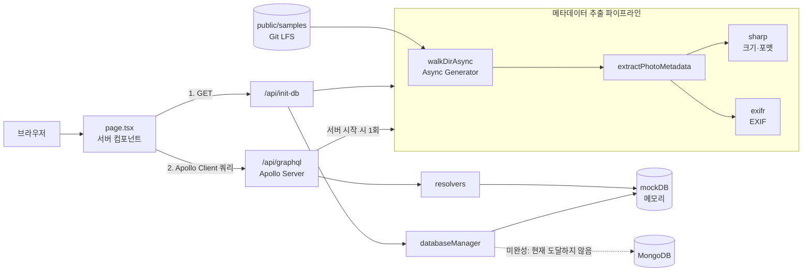

# image-insight

[](https://github.com/loquemedalagana/image-insight/actions/workflows/ci.yml)

한국어 | [English](README.en.md)

로컬 폴더의 JPG에서 이미지 정보와 EXIF를 추출해 GraphQL API로 제공하고, 카테고리 필터가 있는 갤러리로 보여 주는 Next.js 15 풀스택 개인 프로젝트입니다.

| 항목 | 내용 |
| --- | --- |
| 역할 | 1인 개발. 스키마 설계, API, 메타데이터 추출 로직, 화면, 테스트, Docker 환경까지 전부 직접 작성 |
| 기간 | 2025-01 ~ 2025-02 (커밋 82개, AI 도구 없이 작성) / 2026-11 테스트·CI·문서 정리(Claude Code 사용) |
| 핵심 기술 | TypeScript, Next.js 15(App Router), React 19, Apollo Server·Client(GraphQL), graphql-codegen, sharp, exifr, Jest, Docker |
| 상태 | 로컬 실행용 프로토타입. 배포·운영·인증 없음. 저장소는 메모리 mockDB |

<!-- TODO(screenshot): 갤러리 화면 스크린샷을 docs/screenshot-gallery.png 로 추가한 뒤 아래 주석을 해제 -->
<!--  -->

> 스크린샷 자리 (추가 예정)

---

## 구현된 기능

- **메타데이터 추출**: `public/samples` 아래 JPG를 재귀 순회하며 sharp로 크기·포맷을, exifr로 EXIF(카메라, 렌즈, 노출, 촬영 시각, 해상도 등)를 읽어 하나의 레코드로 합칩니다. 폴더 이름이 카테고리가 됩니다.
- **GraphQL API** (`/api/graphql`)
  - Query: `metadata`(카테고리·파일명 필터), `metadataById`, `getCategoryList`
  - Mutation: `addMetadata`, `addCategory`, `deleteMetadataById`
- **DB 초기화 엔드포인트** (`/api/init-db`): 추출한 메타데이터를 저장소에 적재
- **갤러리 화면**: 서버 컴포넌트에서 Apollo Client로 조회, URL 쿼리 기반 카테고리 필터, masonry 목록
- **테스트와 CI**: Jest 테스트 9개(GraphQL API, DB 초기화, 추출 파이프라인, EXIF 파싱). GitHub Actions에서 lint와 테스트 실행
- **Docker/Compose** 개발 환경

## 계획 (미구현)

아래 항목은 코드가 없거나 스키마 정의만 있습니다.

- MongoDB 저장소 실사용 (어댑터 코드만 있음. 아래 기술 스택 참고)
- NeRF 전처리 관련 타입·쿼리·뮤테이션 (GraphQL 스키마에만 있고 resolver 없음)
- EXIF 기반 캘리브레이션 계산 (`calibrationUtils.ts`에 뼈대만 있음)
- CR3 등 RAW 포맷 처리 (WebAssembly)
- 얼굴 인식(face-api.js), 브라우저 이미지 분류(TensorFlow.js)
- 클라우드 스토리지 연동(Backblaze B2 또는 Wasabi)
- 인물 관계 데이터(Neo4j)
- WebGPU/WebGL 기반 이미지 전처리
- 이미지 업로드 UI, 썸네일 생성, 페이지네이션

---

## 기술 스택

`package.json`과 실제 import 기준입니다.

| 구분 | 사용 기술 | 비고 |
| --- | --- | --- |
| 언어 | TypeScript 5 | strict 모드 |
| 프레임워크 | Next.js 15.1 (App Router), React 19 | Route Handler로 API 제공 |
| API | Apollo Server 4, `@as-integrations/next`, GraphQL 16 | `/api/graphql` |
| 클라이언트 | Apollo Client 3 | 서버 컴포넌트에서 조회 |
| 타입 생성 | graphql-codegen | 스키마 → `src/__generated__/graphql.ts` |
| 이미지 처리 | sharp 0.33, exifr 7 | 크기·포맷, EXIF |
| 저장소 | 메모리 mockDB (기본이자 실제로 쓰이는 유일한 저장소) | 서버를 재시작하면 초기화됨 |
| 저장소(미완성) | mongodb 6 드라이버 | 아래 설명 참고 |
| 스타일 | Tailwind CSS 3 | |
| 테스트 | Jest 29 + ts-jest (ESM 모드) | |
| 환경 | Docker(node:18), Docker Compose, GitHub Actions(Node 20) | |
| 파일 관리 | Git LFS | `public/samples`의 샘플 이미지 |

**MongoDB 어댑터 상태**: [`src/lib/mongoDB.ts`](src/lib/mongoDB.ts)와 [`src/lib/databaseManager.ts`](src/lib/databaseManager.ts)에 `USE_MONGO_DB=true`일 때 MongoDB로 분기하는 코드가 있습니다. 하지만 연결 여부를 먼저 확인한 뒤에야 연결을 시도하는 구조라서 지금은 연결이 시작되지 않고 항상 mockDB로 떨어집니다. 또 GraphQL resolver는 `databaseManager`를 거치지 않고 mockDB를 직접 호출합니다. 그래서 MongoDB는 "지원"이 아니라 "미완성"으로 분류했습니다.

`exif-js`, `formidable`, `supertest`, `node-mocks-http`, `@testing-library/*`는 설치만 되어 있고 현재 코드에서 쓰지 않습니다.

---

## 아키텍처



1. 페이지가 렌더링될 때 `/api/init-db`를 먼저 호출해 샘플 폴더의 메타데이터를 저장소에 적재합니다.
2. 이어서 Apollo Client로 카테고리 목록과 메타데이터를 조회합니다. 필터는 URL의 `categoryName` 쿼리를 그대로 `searchCondition`으로 넘깁니다.
3. resolver는 mockDB에서 읽어 조건에 맞게 걸러 반환합니다.

---

## 실행 방법

### 0. 클론과 샘플 이미지

```bash
git clone https://github.com/loquemedalagana/image-insight.git
cd image-insight
```

샘플 이미지는 Git LFS로 관리합니다. 갤러리에서 이미지를 보려면 LFS 파일을 받아야 합니다.

```bash
git lfs install
git lfs pull
```

LFS 파일을 받지 않으면 샘플이 포인터 텍스트로 남아 갤러리가 비어 보입니다. **테스트는 LFS 없이도 통과합니다**(테스트 전용 이미지는 `tests/fixtures`에 일반 파일로 들어 있습니다).

### 1. 로컬 실행

Node.js 20 권장(`.nvmrc`).

```bash
npm ci
NEXT_PUBLIC_BASE_URL=http://localhost:3000 npm run dev
```

`http://localhost:3000`에서 갤러리를, `http://localhost:3000/api/graphql`에서 GraphQL 엔드포인트를 쓸 수 있습니다. `NEXT_PUBLIC_BASE_URL`은 페이지가 자기 API를 호출할 때 쓰므로 꼭 지정해야 합니다.

### 2. Docker 실행

```bash
docker compose up --build
```

Compose 없이 실행하려면:

```bash
docker build -t image-insight .
docker run -p 3000:3000 -e NEXT_PUBLIC_BASE_URL=http://localhost:3000 image-insight
```

### 3. 테스트, lint, codegen

```bash
npm test          # Jest 9개 테스트 (LFS 불필요)
npm run lint      # ESLint
npm run codegen   # types.graphql → src/__generated__/graphql.ts
npm run build     # 프로덕션 빌드 (NEXT_PUBLIC_BASE_URL 필요)
```

---

## 설계 포인트

**1. 스키마 우선 GraphQL과 codegen**
[`types.graphql`](src/graphql/schema/types.graphql)을 단일 원본으로 두고, [`codegen.yml`](codegen.yml)로 서버 타입과 클라이언트 Document를 [`src/__generated__/graphql.ts`](src/__generated__/graphql.ts)에 생성합니다. resolver, mockDB, 화면 컴포넌트가 같은 `Metadata`, `Category` 타입을 공유하므로 스키마를 바꾸면 영향받는 곳이 컴파일 단계에서 드러납니다.

**2. Async Generator 기반 디렉터리 순회**
[`fileUtils.ts`](src/utils/fileUtils.ts)의 `getAllImagesAsync`와 [`extractMetadataFromLocal.ts`](src/lib/extractMetadataFromLocal.ts)의 `walkDirAsync`는 `yield*`로 하위 폴더를 재귀 순회하며 파일을 하나씩 내보냅니다. 전체 경로 목록을 먼저 만들지 않고 `for await`로 한 장씩 처리하며, 한 파일이 실패해도 로그만 남기고 다음 파일로 넘어갑니다.

**3. EXIF가 없는 파일 예외 처리**
[`processExif.ts`](src/lib/processExif.ts)는 EXIF가 없거나 파싱에 실패해도 예외를 던지지 않고 `{ message }` 객체를 반환합니다. EXIF가 있을 때도 필드마다 기본값을 채워 응답 형태를 일정하게 유지합니다. 두 경우 모두 [`processExif.test.ts`](tests/lib/processExif.test.ts)에서 fixture 이미지로 검증합니다.

**4. Docker로 Node 버전 통일**
개발 당시 로컬은 Node 22, 배포를 가정한 환경은 Node 18이어서 [`Dockerfile`](Dockerfile)과 [`docker-compose.yml`](docker-compose.yml)로 실행 환경을 고정했습니다. 소스는 볼륨으로 연결하고 `node_modules`는 컨테이너 것을 쓰도록 분리했습니다.

---

## 한계와 다음 단계

- 배포와 운영 경험은 이 저장소에 없습니다. 로컬과 Docker 개발 환경에서만 실행했습니다.
- 인증과 권한이 없습니다. `addMetadata`는 서버의 파일 경로를 그대로 받으므로 외부에 공개하면 안 됩니다.
- 저장소가 메모리 mockDB라서 서버를 재시작하면 데이터가 사라집니다. MongoDB 어댑터는 미완성입니다.
- resolver가 mockDB를 직접 호출해서 `databaseManager` 추상화와 경로가 둘로 나뉘어 있습니다.
- 테스트는 서버 쪽 로직 중심입니다. 화면 컴포넌트 테스트와 E2E 테스트는 없습니다.
- 페이지네이션 인자(`page`, `limit`)는 받기만 하고 적용하지 않습니다.
- 원본 크기 이미지를 그대로 내려보냅니다. 썸네일 생성이 없습니다.

다음에 손댄다면 순서는 (1) resolver를 `databaseManager`로 통일하고 MongoDB 연결 흐름 수정, (2) 썸네일과 페이지네이션, (3) 인증입니다.

---

## 개발 기록

| 시기 | 내용 | 도구 |
| --- | --- | --- |
| 2025-01 ~ 2025-02 | 설계와 구현 전체. 커밋 82개 | AI 도구 없이 1인 개발 |
| 2026-11 | 테스트 수정, CI 추가, lint 정리, 문서 정리 | Claude Code 사용 |

2026-11 정리 작업의 구분은 다음과 같습니다.

**직접 판단한 것**

- 작업 범위: 기능을 늘리지 않고, clone해서 테스트를 돌렸을 때 문제가 없게 만드는 것까지만
- 테스트가 Git LFS에 의존하지 않도록 fixture를 따로 두고, CI에서도 LFS를 받지 않기로 한 것
- README에서 구현된 것과 계획을 분리하고, 실제 코드에 없는 기술을 스택에서 내리기로 한 것
- 저장소·패키지·Docker 이름을 `image-insight`로 통일
- 원래 코드와 AI 도구를 쓴 작업을 구분해서 기록하기로 한 것
- 회고 문서(`retrospect.md`)와 샘플 이미지 처리는 자동으로 고치지 않고 직접 검토해서 결정

**Claude Code가 한 것** (검토 후 반영)

- 테스트 실패 원인 분석: ESM 모드에서 `jest` 전역이 없는 문제, LFS 포인터 파일을 sharp가 읽지 못하는 문제, 모듈 상태 때문에 실패 케이스 테스트가 스파이를 타지 않는 문제
- sharp로 합성 fixture 이미지 생성([`tests/fixtures/generate.mjs`](tests/fixtures/generate.mjs)), 테스트가 fixture를 보도록 수정
- ESLint 설정 오류 수정과 `any` 타입 정리(동작 변경 없음), Next.js 15의 `searchParams` 타입 수정
- GitHub Actions 워크플로 작성
- README 초안 작성, MongoDB 분기가 실제로는 도달하지 않는다는 점 확인
- 샘플 이미지의 EXIF 개인정보 점검 스크립트 실행과 결과 정리

2025년 당시의 회고는 [`retrospect.md`](retrospect.md)에 있습니다.
